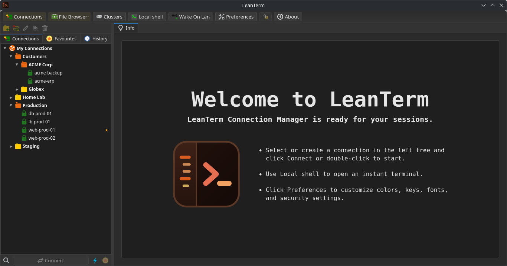
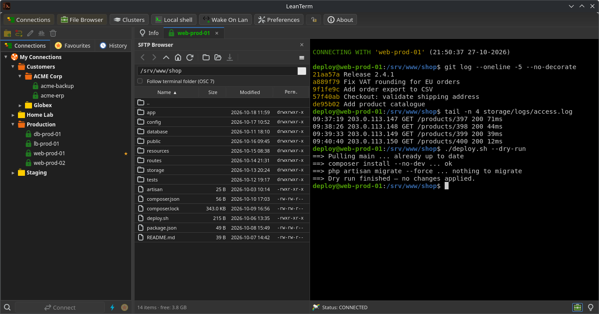
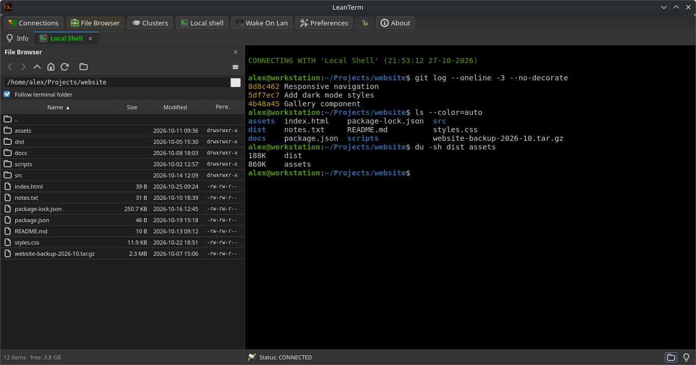

# LeanTerm – Modern Connection Manager

<p align="center"></p>

LeanTerm is a connection and terminal manager for Linux, built with **Go** and **Svelte 5** (via Wails v3). It started as a rewrite of the Perl-based *Ásbrú Connection Manager*: the connection tree, the tabbed terminals, the Expect/variable automation and the clusters will feel familiar to Ásbrú users.

It is **not** a 1:1 copy, though. LeanTerm adds an embedded SFTP browser and a local file browser next to the terminal, a built-in text editor that edits remote files directly over SSH, uses a reworked button bar, and hides rarely used functions (clusters) by default. SSH, SFTP and Telnet are implemented natively in Go, so there are no `ssh`/`sftp`/`expect` wrappers and no shell calls for file operations.

> **Status:** 0.9.0 – usable day to day on Linux (tested on Debian 13 / KDE Plasma, Wayland). Windows and macOS build files exist but are untested.

## 📸 Screenshots

**Welcome screen**



**Connections, SFTP browser and SSH terminal**



**Local shell with the local file browser**



<sub>The screenshots show demo data only.</sub>

---

## 🌟 Key Features

### Lean, Configurable UI
- Main button bar at the top (default) or bottom of the window (*Preferences → Main Options*).
- Toggles in the button bar: **Connections** tree, **File Browser** panels (SFTP and local), **Clusters** functions (hidden by default to keep the UI lean).
- File browser on the left (default) or right side of the terminal (*Preferences → Terminal Options → File browser*).
- Dark (default) or light colour scheme.
- Split terminal tabs, tab colours and a find bar in the terminal.
- Preferences, Edit Connection and About can be moved (title bar) and resized (edges and corners) inside the main window; their position and size are remembered, a double-click on the title bar resets them.
- Two terminal engines (*Preferences → Terminal Options → Look and Feel*): **xterm.js** (default) or the experimental **Ghostty** engine ([ghostty-web](https://github.com/coder/ghostty-web), Ghostty's VT parser as WebAssembly). With Ghostty, colour changes apply to newly opened terminals only, links open with Ctrl+Click and selected text is always copied to the clipboard.
- New connections only need a name; the title is derived from it.
- Closing the window asks for confirmation while connections or file transfers are active (and, with *Confirm exit*, always).

### Native Protocols (No CLI wrappers)
- **Native SSH (Go `x/crypto/ssh`):**
  - Direct connection, SOCKS5 proxies, and multi-hop Jump Host chains (`ProxyJump`).
  - Full authentication: Password, Public Key (+ passphrase), Keyboard-Interactive (OTP), SSH Agent forwarding (`SSH_AUTH_SOCK`), and automatic fallback.
  - Port forwarding: Local (`-L`), Remote (`-R`), and Dynamic SOCKS5 server (`-D`).
  - X11 Forwarding (`x11-req` with MIT-MAGIC-COOKIE from local display).
  - `NoRemoteCommand` support ("Port forwarding only").
  - Host key verification with strict `known_hosts` matching and auto-accept options.
- **Native Telnet (`internal/telnet`):**
  - RFC 854/855/1091/1073/1143 IAC option negotiation engine.
  - Window size negotiation (NAWS) and Terminal Type (`TTYPE`).
  - Automatic prompt login state machine via Perl-compatible regexes (`regexp2`).
  - Interactive escape character prompt (`^]`).
- **Local PTY Shell:**
  - Local terminal using native Unix pseudo-terminals (`creack/pty`); shell, options and start folder are configurable.
- **SFTP-only connections:** open just the file browser without a terminal.

### Embedded SFTP Browser
- Opens on the left or right side of every SSH terminal tab (automatically, per connection or on demand).
- Operates directly over the session's active SSH client (no second login).
- Real-time directory synchronization via **OSC 7** terminal sequences ("Follow terminal folder").
- Full file operations: Upload (drag-and-drop or file dialog), download, rename (F2), delete (Del), mkdir (F7), empty file creation, and chmod (rwx matrix + octal).
- **"Open with default application":** Downloads to a temporary folder, opens with `xdg-open`, watches for changes via `fsnotify`, and prompts to upload modifications back to the remote server.
- Transfer queue with progress, speed and ETA; transfers can be cancelled.
- Files of uploads and downloads are copied in parallel; `parallel_transfers` (1–8) limits how many run at the same time across all tabs.
- Asks before overwriting existing files (Overwrite / Skip existing / Cancel).
- Optional periodic folder polling (`poll_seconds`).

### Local File Browser
- Local shell tabs show the same browser for the local file system (title "File Browser").
- Starts in the shell's working directory; "Follow terminal folder" tracks the shell via `/proc/<pid>/cwd` (no shell integration or OSC 7 needed).
- Double-click opens files directly in their default application; folders are entered.
- The Home button opens your home folder; free space is shown on Linux, macOS, FreeBSD and Windows.
- Copy to… / Move to… instead of upload/download; files dropped from the desktop are copied into the current folder, asking before existing files are overwritten.
- File operations use the Go standard library directly – no shell commands.

### Built-in Text Editor
- Double-click on a text, code, Markdown or configuration file in the SFTP or the local file browser opens it in LeanTerm's editor (or use *Open in Editor* in the context menu; *Preferences → Editor* switches double-click back to the default application).
- Its own window (movable, resizable, minimisable) with one tab per file, a KWrite-like menu bar, toolbar and status bar; it uses LeanTerm's colour scheme (dark or light) and its own font setting.
- **Remote files are read and written directly over the SSH connection** (no temporary copy). Saving writes a temporary file and renames it, keeping permissions and owner; a file changed elsewhere in the meantime is detected (Overwrite / Reload / Cancel). If the connection drops, reconnecting the same connection lets you save again, or you save a local copy.
- No size limit: files above 10 MB ask once, files above 100 MB ask twice and open without syntax highlighting (both limits are configurable).
- Line endings: Unix (LF) / Windows (CRLF) switch in the status bar; encodings UTF-8, UTF-8 with BOM, Windows-1252, ISO-8859-1 and ISO-8859-15 (detected on open, changeable for saving or *Reload with Encoding*).
- Syntax highlighting (CodeMirror 6) for C, C++, Arduino, C#, Java, Kotlin, Dart/Flutter, Go, Rust, Python, Mojo, Nim, Clojure, Lua, Bash, PowerShell, Windows Batch, HTML, CSS/SCSS/Less, JavaScript, TypeScript, React (JSX/TSX), Svelte, Markdown, SQL and the common configuration formats: JSON/JSONC, YAML, TOML, XML, INI/systemd/.env, nginx, Apache, SSH config, crontab, hosts/fstab, Dockerfile, Makefile, CMake, .gitignore, Windows registry (.reg), Protocol Buffers, Jinja2, RPM spec and diff/patch. Detection uses the file name, the extension and the `#!` line.
- Search and replace (regular expressions), go to line, folding, multiple cursors, overwrite mode (Insert), toggle comment, upper/lower case, word wrap and visible whitespace.

### Automation & Productivity
- **Variable Substitution Engine:**
  - Built-in tokens: `<UUID>`, `<SOCKS5_PORT>`, `<TIMESTAMP>`, `<DATE_Y>`, `<DATE_M>`, `<DATE_D>`, `<TIME_H>`, `<TIME_M>`, `<TIME_S>`, `<NAME>`, `<TITLE>`, `<IP>`, `<PORT>`, `<USER>`, `<PASS>`.
  - Global variables (`<GV:name>`) and local variables (`<V:0>` through `<V:9>`).
  - Process environment (`<ENV:NAME>`).
  - Interactive value prompts (`<ASK:n>`, `<ASK:desc|opt1|opt2>`, `<ASK:text>`).
  - Local command evaluation (`<CMD:command>`).
  - Control tags (`<CTRL_X:cmd>`, `<TEE:file>`, `<PIPE:cmd>`).
  - KeePassXC masks (`<field|entry>` or `<Password|entry>`).
- **Expect Engine (`internal/session/expect.go`):**
  - Multiline regex matching with lookahead/backreferences (`github.com/dlclark/regexp2`).
  - Actions on match/fail: `next`, `stop`, `goto` (with 1000-jump loop guard).
  - Delay support and progress tracking.
- **Connection Chains:**
  - Drag and drop any connection from the tree directly onto an active terminal.
  - Interactive Chain Selection Dialog to review and selectively execute the chained Expect commands.
  - Preference to automatically skip initial login prompts (`skip_first_chain_expect`).
- **Clusters & Power Cluster Controller (PCC):**
  - Group active terminals into ad-hoc, configured, or regex-based auto-clusters.
  - Broadcast keystrokes in real time to all cluster members.
  - PCC window to send commands (with variable substitution) across all clustered terminals.
- **KeePassXC Integration:**
  - Direct querying via `keepassxc-cli` with master password passed over secure stdin.
  - Transparent tag replacement for `<Password|entry>`, `<UserName|entry>`, etc.
  - In-memory credential caching with automatic TTL expiration.
- **Pipe & Tee Output:**
  - `<TEE:filepath>` mirrors all terminal output to a local log file.
  - `<PIPE:command>` pipes terminal output to an external process and streams output to a dedicated Piped Output Window.
- **Wake on LAN & Bulk Edit:**
  - UDP magic packet generator and `/proc/net/arp` reader.
  - Safe bulk search-and-replace across connections without `eval`.

### Security
- Secrets are encrypted using **`filippo.io/age`** (X25519 & scrypt) and stored in `secrets.age`.
- The vault key is kept in the OS keyring (Secret Service / libsecret via D-Bus) or protected by a master password.
- Passwords are never written to `config.toml` or passed as process arguments.
- Lock button to lock the GUI with the master password.

---

## 🛠️ Installation & Building

### Debian / Ubuntu Package (.deb)
Download `leanterm_0.9.0_amd64.deb` from the [Releases](https://github.com/Suvukaraz/leanterm/releases) page and install it:
```bash
sudo apt install ./leanterm_0.9.0_amd64.deb
```

Runtime dependencies: GTK4 and WebKitGTK 6.0 (`libgtk-4-1`, `libwebkitgtk-6.0-4`, e.g. Debian 13 / Ubuntu 24.04 or newer); `apt` installs them automatically.

> **Upgrading from LinXTerm:** LeanTerm was previously called LinXTerm. The package replaces `linxterm`, and on first start `~/.config/linxterm` is moved to `~/.config/leanterm` (including the keyring entry), so all connections are kept.

To build the `.deb` package from source (builds the frontend and the binary, then packages them into `bin/`):
```bash
npm --prefix frontend install
./build/package-deb.sh 0.9.0
```

### Building from Source
**Prerequisites:**
- Go ≥ 1.26
- Node.js ≥ 20.19 & npm
- GTK4 / WebKitGTK 6.0 development headers (`libgtk-4-dev`, `libwebkitgtk-6.0-dev`)

**Build steps:**
```bash
# 1. Install frontend dependencies
npm --prefix frontend install

# 2. Build frontend production bundle
npm --prefix frontend run build

# 3. Build standalone binary (embeds frontend/dist)
go build -o bin/leanterm .
```

The JavaScript bindings in `frontend/bindings` are committed. After changing a Go service API, regenerate them with `wails3 generate bindings -clean=true`.

---

## 💻 CLI Usage

```
leanterm [options]

Options:
  --config-dir=<path>         Configuration directory (default: ~/.config/leanterm,
                              or $LEANTERM_CONFIG_DIR)
  --temp-dir=<path>           Temporary directory
  --start-uuid=<id>[:<clust>] Start the connection with the given UUID (can be repeated)
  --edit-uuid=<id>            Open the edit window for the connection
  --dump-uuid=<id>            Print the connection as TOML and exit
  --list-uuids                Print all connections and groups (UUID/Type/Method/Name)
  --quick-conn                Open the Quick Connect window on startup
  --start-shell               Open a local shell on startup
  --preferences               Open the Preferences window on startup
  --readonly                  Read-only mode (configuration changes are not saved)
  --no-backup                 Do not create configuration backups on startup
  --password=<pwd>            Master password to unlock stored credentials
  --verbose, -v               Debug logging
  --help, -h                  Show help and exit
```

A second start hands its options to the running instance unless *Allow more than one instance* is enabled.

---

## ⚙️ Configuration Reference (`config.toml`)

LeanTerm stores its configuration in human-readable TOML in `~/.config/leanterm/config.toml`; window and panel layout is kept in `state/ui.toml`. All secrets are stored separately in `secrets.age`. Every option is listed with its default in [`docs/config-reference.md`](docs/config-reference.md); the most important ones:

### Section `[general]`
| Key | Type | Default | Description |
|---|---|---|---|
| `layout` | string | `"traditional"` | `"traditional"` or `"compact"` |
| `theme` | string | `"default"` | Icon theme: `"default"`, `"asbru-color"`, `"asbru-dark"`, `"system"` |
| `start_main_maximized` | bool | `false` | Start main window maximized |
| `confirm_exit` | bool | `true` | Ask before quitting |
| `auto_save` | bool | `true` | Automatically save configuration changes |
| `protect_with_password` | bool | `false` | Master password protection for GUI and secrets |
| `auto_accept_host_keys` | bool | `true` | Automatically accept and store new SSH host keys |
| `allow_multiple_instances` | bool | `false` | Allow more than one running instance |

### Section `[appearance]`
| Key | Type | Default | Description |
|---|---|---|---|
| `color_scheme` | string | `"dark"` | `"dark"` or `"light"` |
| `tree_position` | string | `"left"` | Connection tree on the `"left"` or `"right"` |
| `button_bar_position` | string | `"top"` | Main button bar at the `"top"` or `"bottom"` |

### Section `[terminal]`
| Key | Type | Default | Description |
|---|---|---|---|
| `show_status_bar` | bool | `true` | Show terminal status bar with port forwarding and state |
| `engine` | string | `"xterm"` | Terminal engine: `"xterm"` (xterm.js) or `"ghostty"` (experimental, see below); applies to newly opened terminals |
| `macros_bar` | string | `"never"` | Toolbar mode for macros: `"never"`, `"combo"`, `"buttons"` |
| `show_global_macros` | bool | `false` | Display global macros alongside connection macros |
| `confirm_chains` | bool | `true` | Prompt for confirmation when dropping connection chain |
| `skip_first_chain_expect` | bool | `true` | Skip the first Expect entry during chained execution |
| `max_reconnect_attempts` | int | `50` | Max automated reconnection attempts on drop |

### Section `[sftp_browser]`
| Key | Type | Default | Description |
|---|---|---|---|
| `auto_open` | bool | `true` | Open the file browser automatically (SSH and local shells) |
| `position` | string | `"left"` | File browser on the `"left"` or `"right"` of the terminal |
| `width` | int | `340` | Default width of the file browser in pixels |
| `follow_terminal_folder` | bool | `false` | Follow the shell's folder (SSH via OSC 7, local shells directly) |
| `show_hidden` | bool | `false` | Show hidden (dot) files in browser |
| `confirm_delete` | bool | `true` | Prompt for confirmation before deleting files |
| `parallel_transfers` | int | `3` | Maximum number of files transferred at the same time (1–8) |
| `preserve_timestamps` | bool | `true` | Keep modification times when copying |
| `preserve_permissions` | bool | `true` | Keep permissions when copying |
| `poll_seconds` | int | `0` | Polling interval in seconds (0 = disabled) |

### Section `[editor]`
| Key | Type | Default | Description |
|---|---|---|---|
| `font` | table | `Monospace`, 11 pt | Editor font (`family`, `size` in points) |
| `open_text_files_in` | string | `"editor"` | Double-click on a text file opens it in `"editor"` or `"default_app"` |
| `tab_width` | int | `4` | Tab width (1–16) |
| `indent_with_tabs` | bool | `false` | Indent with tabs instead of spaces |
| `word_wrap` | bool | `false` | Wrap long lines |
| `show_whitespace` | bool | `false` | Show spaces and tabs |
| `large_file_mb` | int | `10` | Ask once before opening larger files |
| `huge_file_mb` | int | `100` | Ask twice before opening larger files; they start without syntax highlighting |

### Section `[keepass]`
| Key | Type | Default | Description |
|---|---|---|---|
| `enabled` | bool | `false` | Enable KeePassXC password manager integration |
| `database` | string | `""` | Path to `.kdbx` database file |
| `key_file` | string | `""` | Optional path to key file |

### Connection Definition `[[connections]]`
```toml
[[connections]]
id = "c1b2c3d4-..."
name = "Production Web Server"
title = "Prod Web 01"
method = "ssh" # "ssh" | "telnet" | "sftp"
host = "192.168.1.100"
port = 22
auto_reconnect = true

[connections.auth]
type = "password" # "password" | "publickey" | "manual"
user = "deploy"

[connections.ssh]
forward_x11 = true
forward_agent = true
gateway_ports = false

[[connections.expect]]
pattern = "[#$] "
send = "uptime"
append_return = true
on_match = "next"
```

---

## 🧪 Testing

To execute all Go unit tests:
```bash
go test ./internal/...
```

To run frontend Vitest suites and TypeScript checks:
```bash
npm --prefix frontend test -- --run
npm --prefix frontend run check
```

---

## 📄 License
LeanTerm is licensed under the **GNU General Public License v3.0 (GPLv3)**.
