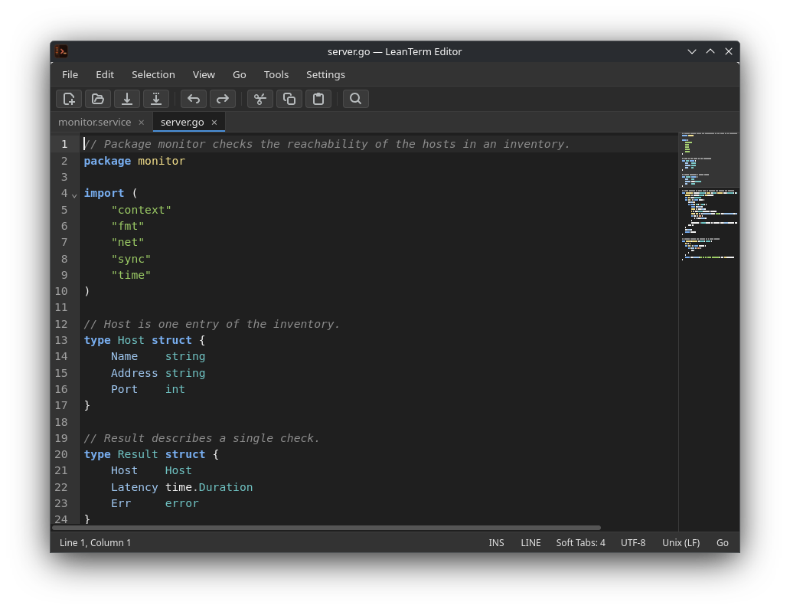

<p align="center"></p>

<h1 align="center">LeanTerm</h1>

<p align="center">
  <b>SSH, Telnet and SFTP connection manager for Linux and Windows</b><br>
  Connection tree, tabbed terminals, file browser and a built-in editor for remote files – in one lean application.
</p>

<p align="center">
  <a href="https://github.com/Suvukaraz/leanterm/releases/latest"></a>
  
  <a href="LICENSE"></a>
  <a href="https://github.com/Suvukaraz/leanterm/actions/workflows/windows.yml"></a>
</p>

## Installation

**Linux** – one command for Debian, Ubuntu, Fedora, openSUSE, Arch and their derivatives:

```sh
curl -fsSL https://raw.githubusercontent.com/Suvukaraz/leanterm/main/install.sh | sh
```

**Windows 10/11** – download and run [`leanterm_<version>_windows_amd64_setup.exe`](https://github.com/Suvukaraz/leanterm/releases/latest).

More options (packages, updates, uninstalling) are described [below](#installation-details).

## Screenshots

<p align="center">
  <br>
  <em>Connection tree, SFTP browser and SSH terminal</em>
</p>

<p align="center">
  <br>
  <em>Local shell with the local file browser following the shell's folder</em>
</p>

<p align="center">
  <br>
  <em>Built-in editor: syntax highlighting, KWrite-style menus, tabs and minimap</em>
</p>

<p align="center"><sub>The screenshots show demo data only.</sub></p>

## Features

- **Native protocols** – SSH (jump hosts, SOCKS5 proxies, local/remote/dynamic port forwarding, agent forwarding, X11, keyboard-interactive/OTP), Telnet and SFTP implemented in Go; no external `ssh`, `sftp` or `expect` required.
- **Terminals** – tabs and split tabs, find bar, tab colours; local shell via PTY (Linux) or ConPTY (Windows).
- **Two terminal engines** – [Rio](https://github.com/raphamorim/rio)'s terminal core via [rioterm](https://github.com/raphamorim/riotermjs) (default) or [Ghostty](https://ghostty.org)'s terminal core via [ghostty-web](https://github.com/coder/ghostty-web), selectable in *Preferences → Terminal Options*. Both run as WebAssembly inside LeanTerm, so Rio's and Ghostty's terminal emulation is available on Linux and Windows alike.
- **File browser** – SFTP and local files next to the terminal: drag and drop, parallel transfers with queue, follows the shell's folder, open with the default application and upload changes back.
- **Editor** – edits local and remote files directly over SSH; syntax highlighting for 50+ languages and configuration formats, KWrite-style *Selection* and *Go* menus, bookmarks, block selection and minimap.
- **Automation** – variables and prompts, Expect sequences, connection chains, clusters with broadcast input, pipe/tee of terminal output.
- **Security** – secrets encrypted with [age](https://age-encryption.org) and kept in the system keyring or behind a master password; KeePassXC integration; GUI lock.
- **Organisation** – connection tree with groups, favourites, history, quick connect, Wake-on-LAN and bulk edit.

## Installation details

### Linux

The install script detects the distribution, installs the matching package with all dependencies and verifies the download against the release checksums. Running it again updates LeanTerm; options follow `sh -s --`:

```sh
curl -fsSL https://raw.githubusercontent.com/Suvukaraz/leanterm/main/install.sh | sh -s -- --version 1.0.0
curl -fsSL https://raw.githubusercontent.com/Suvukaraz/leanterm/main/install.sh | sh -s -- --uninstall
```

| Distribution | Installed as |
|---|---|
| Debian 13+, Ubuntu 24.04+, Mint 22, Pop!_OS, Zorin | `.deb` package via `apt` |
| Fedora 39+, RHEL/Alma/Rocky 10, openSUSE Tumbleweed/Leap 16, Arch, Manjaro | libraries from the distribution, LeanTerm in `/usr/local` |

Requirements: x86_64, glibc 2.34+, GTK 4.10+ and WebKitGTK 6.0 – Debian 12 and Ubuntu 22.04 ship an older GTK and are not supported. The `.deb` and `.tar.gz` packages are also available on the [releases page](https://github.com/Suvukaraz/leanterm/releases/latest).

### Windows

The installer puts LeanTerm into `C:\Program Files\LeanTerm`, adds Start menu and desktop shortcuts and installs the WebView2 runtime if needed. It is not code-signed yet, so SmartScreen asks for confirmation on the first start. Windows 10 version 1809 or later is required.

### Platform differences

| | Linux | Windows |
|---|---|---|
| Configuration | `~/.config/leanterm` | `%APPDATA%\LeanTerm` |
| Local shell | `$SHELL` | PowerShell 7, Windows PowerShell or `cmd.exe` |
| Commands (pre/post, `<CMD:…>`) | `/bin/sh` | `cmd.exe` |
| SSH agent | `SSH_AUTH_SOCK` | Windows OpenSSH agent or a pipe in `SSH_AUTH_SOCK` (e.g. Pageant) |
| X11 forwarding | local X server | VcXsrv, X410 or another X server on `localhost:0` |

## Configuration

Settings are edited in *Preferences* and stored as TOML in `config.toml` (window layout in `state/ui.toml`); passwords are kept separately in the encrypted `secrets.age`. All options with their defaults are listed in [docs/config-reference.md](docs/config-reference.md).

Start options such as `--start-uuid`, `--start-shell`, `--edit <file>` or `--config-dir` are listed with `leanterm --help`.

## Building from source

Requirements: Go 1.26+, Node.js 20.19+, and on Linux the GTK 4 / WebKitGTK 6.0 development packages (`libgtk-4-dev`, `libwebkitgtk-6.0-dev`).

```sh
npm --prefix frontend install
npm --prefix frontend run build
go build -o bin/leanterm .
```

| Package | Command |
|---|---|
| Debian package | `./build/package-deb.sh 1.0.0` |
| Linux archive (used by `install.sh`) | `./build/package-tarball.sh 1.0.0` |
| Windows installer (cross-compiled, needs `nsis` and `wails3`) | `./build/package-windows.sh 1.0.0` |

Tests: `go test ./internal/...`, `npm --prefix frontend test -- --run` and `npm --prefix frontend run check`. The JavaScript bindings in `frontend/bindings` are generated with `wails3 generate bindings -clean=true` after changing a Go service.

## License

LeanTerm is licensed under the [GNU General Public License v3.0](LICENSE).

<sub>LeanTerm is inspired by Ásbrú Connection Manager and MobaXterm.</sub>
